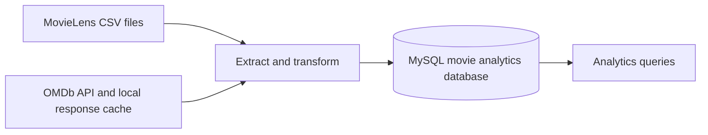
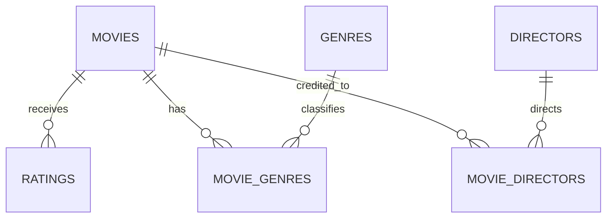

# Movie Data Pipeline

A small Python ETL project for the tsworks Data Engineering assignment. It loads the MovieLens small dataset, enriches movie records with OMDb metadata when available, and stores the results in MySQL for analysis.

## Pipeline at a glance



The pipeline parses release years and decades, splits pipe-separated genres, normalizes director and genre relationships, and upserts records so repeated runs do not create duplicate movies or ratings.

## Project files

```text
.
|-- etl.py              # Extract, transform, and load pipeline
|-- schema.sql          # MySQL database and table definitions
|-- queries.sql         # Four assignment analytics queries
|-- requirements.txt    # Python dependencies
|-- .env.example        # Example local configuration
|-- .gitignore          # Excludes credentials and generated/local data
`-- README.md
```

The downloaded MovieLens files and `data/omdb_cache.json` are generated/local data and are excluded from Git. The local `.env` file contains credentials and must not be committed.

## Data model



| Table | Contents |
|---|---|
| `movies` | One row per MovieLens movie, including release year, decade, and available OMDb metadata |
| `ratings` | User ratings, keyed by `(user_id, movie_id)` |
| `genres`, `movie_genres` | Genre lookup and movie-to-genre many-to-many relationship |
| `directors`, `movie_directors` | Director lookup and movie-to-director many-to-many relationship |

Ratings are stored separately from movies so aggregates are calculated from the rating facts. Foreign keys keep ratings and relationship rows tied to valid movies and lookup values.

## Requirements

- Python 3.10 or newer
- MySQL 8 or newer, running locally or reachable with the configured connection settings
- An OMDb API key for new metadata lookups ([request a key](https://www.omdbapi.com/apikey.aspx))

## Setup on Windows

Open PowerShell in the project directory and run:

```powershell
py -m venv .venv
Copy-Item .env.example .env
```

Edit `.env` with the MySQL credentials and OMDb key:

```dotenv
MYSQL_HOST=localhost
MYSQL_PORT=3306
MYSQL_USER=root
MYSQL_PASSWORD=your_mysql_password
MYSQL_DATABASE=movie_analytics
OMDB_API_KEY=your_omdb_api_key
OMDB_MAX_MOVIES=100
```

Install the dependencies and run the ETL using the virtual environment's Python. These commands avoid PowerShell script-activation policy issues:

```powershell
.\.venv\Scripts\python.exe -m pip install -r requirements.txt
.\.venv\Scripts\python.exe etl.py --limit 0
```

The first run creates the database and tables, downloads and extracts MovieLens if needed, applies any cached OMDb responses, and loads the CSV data. The database user must have permission to create the configured database and tables.

## Running the pipeline

```powershell
# Load CSVs and use cached OMDb responses; make no new API lookups
.\.venv\Scripts\python.exe etl.py --limit 0

# Make up to 100 new uncached OMDb lookups in this run
.\.venv\Scripts\python.exe etl.py --limit 100

# Load the MovieLens data without applying or requesting OMDb data
.\.venv\Scripts\python.exe etl.py --skip-api
```

OMDb responses are cached in `data/omdb_cache.json`. Re-running with a positive limit applies cached results and attempts new lookups for uncached titles up to that limit. This lets enrichment continue over multiple runs while respecting the API plan's limits. If OMDb is unavailable, titles still load from MovieLens; unavailable metadata remains empty.

## Viewing the analytics results

After the ETL finishes, run the included helper to print warehouse counts and all four query results in PowerShell:

```powershell
.\.venv\Scripts\python.exe _run_queries.py
```

The assignment queries are also in `queries.sql` and can be run with a MySQL client. Q1 and Q2 require at least 50 ratings to avoid results dominated by very small samples. Q3 counts directors present in OMDb enrichment; its result reflects current enrichment coverage.

## Current verified results

Verified in this workspace after loading the full MovieLens small dataset and applying the local OMDb cache:

| Check | Result |
|---|---|
| Movies loaded | 9,742 |
| Ratings loaded | 100,836 |
| Movies matched with OMDb | 3,060 |
| Genres loaded | 19 |
| Q1: highest average movie rating (at least 50 ratings) | *The Shawshank Redemption* (1994), 4.429 from 317 ratings |
| Q2: top five genres by average rating (at least 50 ratings per genre) | Film-Noir, War, Documentary, Crime, Drama |
| Q3: director with the most enriched movies | Alfred Hitchcock, 37 movies |
| Q4: average rating by release year | 106 years returned, from 1902 onward |

OMDb coverage is partial, but all MovieLens movies and ratings are loaded. Q1, Q2, and Q4 use the MovieLens ratings. Q3 depends on the director metadata currently available from OMDb and may change as enrichment grows.

## Design notes and assumptions

- MovieLens titles that end in a four-digit year are parsed into `release_year`; `decade` is derived from that year.
- When `links.csv` is present, the IMDb ID is tried first for OMDb matching, followed by title and year. The pipeline still works when `links.csv` is absent.
- `(no genres listed)` is treated as no genre.
- Missing OMDb values such as `N/A` are stored as `NULL`. Unmatched movies are retained.
- Box office values are stored as integer USD amounts; no inflation adjustment is applied.
- Director names are split on commas as returned by OMDb.
- Repeated runs use MySQL upserts. Genre relationships are rebuilt from the CSV; director relationships are rebuilt only for movies enriched during that run.

## Challenges and possible next steps

Title mismatches are handled by preferring IMDb IDs and then falling back to title/year lookups. OMDb responses are cached to reduce repeated requests, and transient or authorization/quota errors do not prevent the MovieLens data from loading.

For a production version, the pipeline could add automated tests and run tracking, move raw data to object storage, use a managed orchestration tool, and replace per-title API requests with a rate-limited enrichment worker or bulk metadata source.
